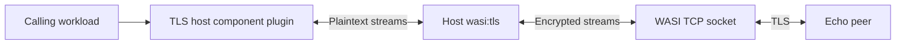

# TLS from a host component plugin

A runnable example of `wasi:tls@0.3.0-draft` wrapping a
`wasi:sockets@0.3.0` TCP connection inside a host component plugin. A caller
workload invokes `example:tls/client.ping`; the plugin completes a verified TLS
handshake, sends `PING\r\n`, and returns the echo peer's reply.

**Status: experimental reference example.** The components build with `wash`
2.7.0, targeting `wasm32-wasip2`; CI uses stable Rust. The verifier uses wasmCloud
source revision `e764379bc2677198a335dc7ff58dc9e0bda0f1e3`, which includes
the merged TLS support, and Wasmtime 48.0.10 from the verifier lockfile.
The TLS WIT is a draft, shared at the repository's top level in
[`wit-deps`](../../../wit-deps/README.md) to match the host implementation.

## How it works



The important code is in [`src/plugin.rs`](src/plugin.rs):

1. Connect the TCP socket using the host's egress policy.
2. Forward its encrypted receive stream through a bounded bridge into
   `Connector.receive`.
3. Pass an application stream to `Connector.send` and send the resulting
   encrypted stream through the socket.
4. Call `Connector.connect` **after wiring both directions**, passing the
   original hostname for certificate verification and SNI.
5. Send application bytes only after the handshake succeeds.
6. At plaintext EOF, stop the ciphertext bridge and check both TLS and socket
   completion futures before reporting success.

The address is an IP literal and port, such as `192.0.2.10:7443` or
`[2001:db8::1]:7443`. The separate `server-name` is the certificate identity,
usually the DNS hostname that resolved to that IP. Resolving a hostname does
not change the identity the certificate must prove.

This one-shot example has a five-second overall deadline and a 1024-byte reply
limit. Closing its application output emits TLS `close_notify`; the echo peer
also closes its TLS output. Stream EOF alone does not prove a clean exchange:
completion futures carry failures such as truncated TLS records.
The ciphertext bridge stops at TLS EOF so a peer that sends `close_notify`
without TCP FIN does not hold the call open. Ending that bridge does not bypass
TLS validation: both TLS completion futures must still succeed, including the
check for a missing `close_notify`.

## Host requirements and certificate trust

The host needs both `host-component-plugins` and `wasi-tls` enabled.
It must include the TLS fixes merged in
[wasmCloud PR #6014](https://github.com/wasmCloud/wasmCloud/pull/6014):

- Classify the linked TLS draft as a host builtin, so the component-plugin
  loader does not search for another plugin to provide it.
- Forward the engine's configured TLS provider into component-plugin stores,
  so operator-supplied certificate authorities are actually used there.

These behaviors are included in the source revision below.
Use a release containing those fixes once available; the earlier 2.12.2
release does not contain them.
Certificate and hostname verification remain enabled.

The verifier's native host installs a `SharedTlsProvider` backed by rustls and
trusts a freshly generated test certificate. See the complete provider in
[`verification/tls.rs`](verification/tls.rs) and its use in
[`verification/harness.rs`](verification/harness.rs). Real deployments should
populate their host-controlled trust store with the appropriate CAs.
`http_client_ca_paths` configures the HTTP client's trust separately; it does
not configure this raw socket's TLS provider. Mutual TLS is outside this example.

TLS retains the socket egress restrictions. The verifier enables host loopback
and grants the plugin only its test peer's port; the caller has no network grant.
It also tests denial when that plugin grant is absent.

## Build and verify

Requires Rust with `wasm32-wasip2`, `wash`, Git, Node.js 22+, and a C toolchain
for the native host's TLS dependencies. Run from this directory:

```sh
# Stop at the first failed command without changing the calling shell's options.
TLS_RUNTIME_DIR="$(mktemp -d)/wasmCloud"
(
set -eu
cargo test --locked

# Use the upstream revision containing the merged TLS fixes.
git clone https://github.com/wasmCloud/wasmCloud.git "$TLS_RUNTIME_DIR"
git -C "$TLS_RUNTIME_DIR" checkout e764379bc2677198a335dc7ff58dc9e0bda0f1e3
node verification/run.mjs --runtime-source "$TLS_RUNTIME_DIR"
)
```

`verification/run.mjs` builds both components unless `--skip-build` is supplied.
Component builds explicitly use each project's local `target` directory,
overriding inherited environment settings and Cargo's `build.target-dir` configuration.
The native harness still uses the cache selected by `--target-dir`.
It creates a temporary native harness, starts real component-plugin and caller
stores, and uses local TLS peers on dynamically allocated ports. No Docker,
database, public endpoint, or real credentials are required.
`--target-dir /path/to/cache` reuses native build artifacts; `--offline` uses
already cached dependencies. The verifier and its lockfile are pinned to
Wasmtime 48.0.10; validate newer runtime revisions separately.

The ten native integration checks cover:

- A verified round trip through the actual host component plugin.
- A verified reply and TLS `close_notify` while the peer keeps TCP open past
  the call deadline; the call must succeed without waiting for TCP FIN.
- Untrusted, expired, and wrong-host certificates; no application bytes reach
  the peer after a rejected handshake.
- Egress denied before TLS starts.
- A stalled handshake hitting the overall deadline.
- An oversized reply hitting the response bound.
- A complete plaintext reply followed by an unclean TLS close, which must still
  fail through the TLS completion future.
- Recognition of the exact TLS draft version linked by the host.

The caller in [`verification/caller`](verification/caller/) exposes an HTTP
handler that invokes the TLS capability. The harness sends it requests such as
`/?address=<test-peer-ip>:<port>&name=localhost` and checks the returned body
and failure reason, rather than treating any TLS error as a successful negative
test. In particular, a wrong-host test must report a hostname mismatch rather
than an unrelated CA failure.

## Applying the pattern to Couchbase

The [Couchbase sockets plugin](../couchbase-wasi-sockets-p3/README.md#tls)
implements this wiring for persistent connections behind its `tls` Cargo feature.
Its existing KV framing and authentication run over the plaintext TLS streams.
A persistent database connection keeps its streams and completion futures
alive and reads protocol frames per operation. The echo example closes each
connection after one exchange.

For `couchbases://`, Couchbase's default encrypted ports are `11207` for KV
and `18093` for SQL++. SQL++ uses HTTPS through `wasi:http` and its own trust
configuration. See [Couchbase's port reference](https://docs.couchbase.com/server/current/install/install-ports.html).
Include transport mode and TLS identity in a connection cache key, and keep
the entire connection/handshake inside the operation's deadline.

Run the real Couchbase TLS and HTTPS scenario with:

```sh
node verification/run.mjs --runtime-source "$TLS_RUNTIME_DIR" --couchbase
```

This adds Docker Compose and OpenSSL requirements.
It runs the shared forty-step scenario through the actual Couchbase host
plugin, including encrypted KV CRUD and SQL++ HTTPS, then the ten TLS tests above.
The fixture publishes only dynamic host-loopback ports and is removed afterward.
TLS does not add multi-node routing or Capella support to the Couchbase plugin.
